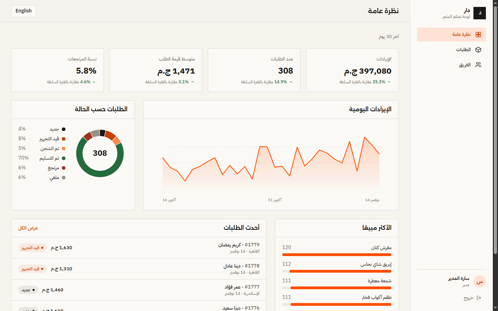
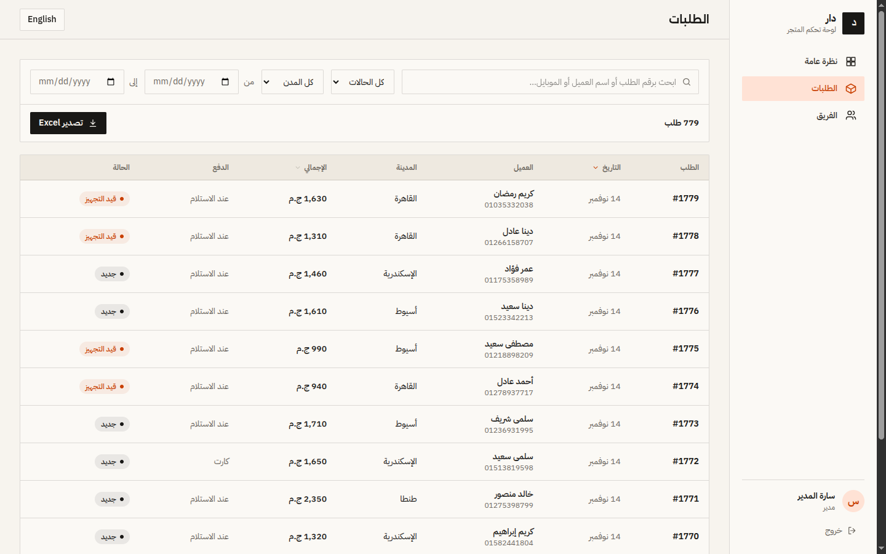
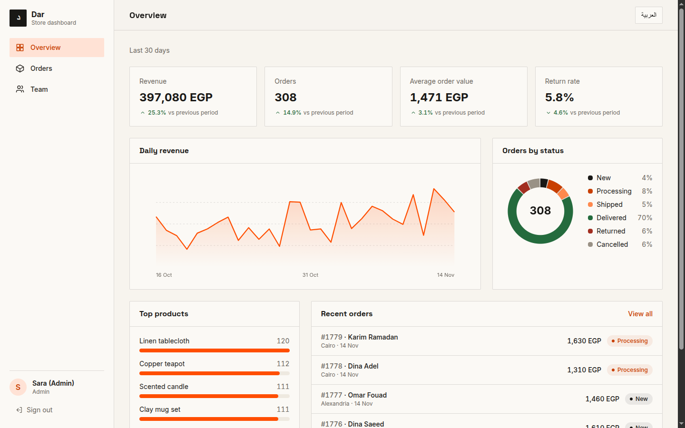
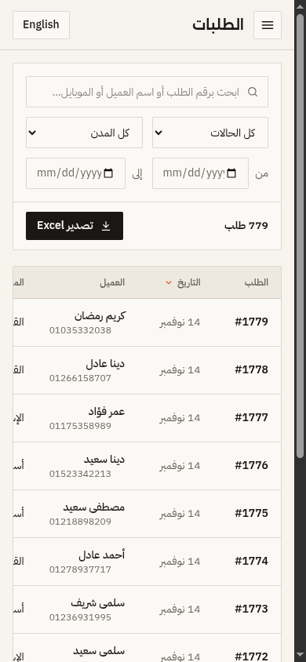

# Dar — store admin dashboard (concept)

A bilingual (Arabic RTL / English) admin dashboard for a small online store: orders, revenue,
role-based access and Excel export. It is a **concept project** with seeded fake data.



## Try it

**Live demo:** <https://dar-store-dashboard.vercel.app/>

| Role | Email | Password | Sees |
| --- | --- | --- | --- |
| Admin | `admin@dar.demo` | `admin123` | Everything: revenue, export, team |
| Staff | `staff@dar.demo` | `staff123` | Orders and status updates only |

The login page has one-click buttons that fill these in.

## Features

- **Overview:** revenue, orders, average order value and return rate for the last 30 days, each compared with the previous 30.
  Daily revenue chart with hover values, orders-by-status donut, top products, and recent orders.
- **Orders:** search by order number, customer or phone; filter by status, city and date range; sort by date or total;
  paginate; open any order in a side drawer and change its status. The change persists in the browser.
- **Excel export:** exports the current filtered view as a UTF-8 CSV with a BOM, so Arabic opens correctly in Excel. Admin only.
- **Roles:** staff accounts never see money: KPIs, totals, the chart and export are hidden, and the Team page is blocked.
- **Arabic and English** with a one-click switch. Direction, fonts and number formats follow the language.
- **No chart library.** The charts are hand-written SVG, so the bundle stays small and RTL is under control.



| English | Mobile |
| --- | --- |
|  |  |

## Honest limits

This is a front-end demo. Sign-in and roles are enforced in the browser only, and data is generated from a seed.
In a client project the same screens sit on a real backend: authentication (NextAuth or Supabase Auth),
roles enforced in the API, and a database (PostgreSQL or MySQL). The UI code stays the same.

## Stack

Next.js 16 (App Router, static export) · React 19 · TypeScript · Tailwind CSS 4 · Inter / Space Grotesk / IBM Plex Sans Arabic / Alexandria.

```bash
pnpm install
pnpm dev      # http://localhost:3000
pnpm build    # static site in out/
```

---

## بالعربي

لوحة تحكم لمتجر إلكتروني بالعربي والإنجليزي (مشروع تجريبي ببيانات وهمية):
مؤشرات الإيرادات والطلبات مقارنة بالشهر اللي فات، رسم بياني للإيرادات اليومية، جدول طلبات فيه بحث وفلترة بالحالة
والمدينة والتاريخ وترتيب وتقسيم صفحات، تفاصيل كل طلب وتغيير حالته، وتصدير Excel بيفتح العربي صح.
فيه صلاحيتين: المدير يشوف كل حاجة، والموظف يشوف الطلبات بس من غير أي أرقام مالية.

---

Designed and built by **[Mahmoud Elnagdy](https://nagdista.com/)** — full-stack developer in Cairo, Egypt.
